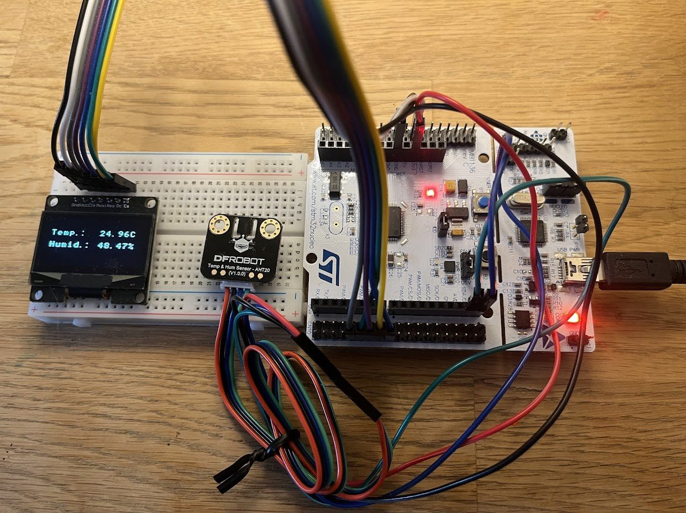
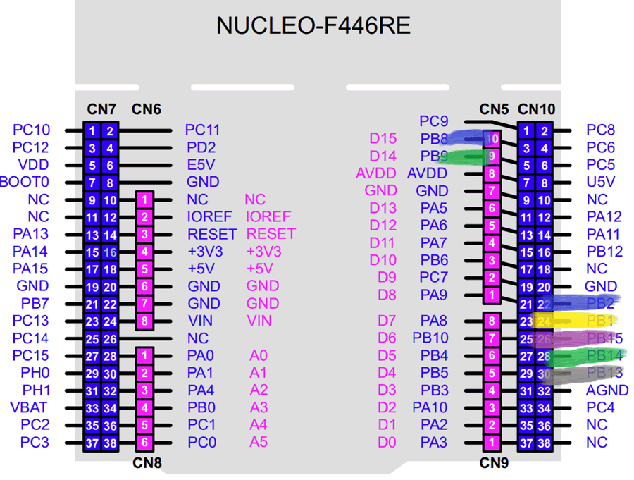

# Weather station

A temperature and humidity station for the NUCLEO-F446RE using an AHT20
sensor and a 128x64 SH1106 OLED display.

Register-level drivers handle I2C, SPI, UART, timers, and the user button.
Readings appear on the display and over UART. After 5 seconds, the display
turns off and the CPU sleeps while waiting for a button press or serial input.

<a href="weather-station.jpg"></a>

## Hardware and wiring

- ST NUCLEO-F446RE development board
- AHT20 temperature and humidity sensor
- Joy-IT SBC-OLED01.3 1.3" OLED display, configured for SPI
- Dupont jumper wires

Connect both modules to the board's 3.3 V and GND pins.

| Module | Signal | Board pin |
| ------ | ------ | --------- |
| AHT20 | SCL | PB8 (D15) |
| AHT20 | SDA | PB9 (D14) |
| OLED | Clk | PB13 |
| OLED | Mosi | PB15 |
| OLED | Res | PB2 |
| OLED | Dc | PB1 |
| OLED | Cs | PB14 |

The AHT20 uses I2C address `0x38`.

<a href="pins.png"></a>

## Build and flash

Requires `arm-none-eabi-gcc`, `make`, and `st-flash` on Linux or WSL.
Connect the board through its ST-LINK USB port and run from this directory:

```sh
make
make flash
make clean
```

Build output is saved in `build/`. CMSIS headers are reused from
`../01_blinky-evolution/01_hal-loop/`.

## Usage

A reading is taken at startup. Press the blue user button to request another.

Open the ST-LINK virtual COM port at **115200 baud, 8N1, no flow control**.
For example, on Linux or WSL:

```sh
screen /dev/ttyACM0 115200
```

Replace `/dev/ttyACM0` with your serial device. Send a single character:

| Command | Action |
| ------- | ------ |
| `r` | Request a temperature and humidity reading |
| `t` | Print uptime in milliseconds |
| `l` | Print the LED state |

## License

See [LICENSE.md](../LICENSE.md) for original and third-party code licenses.
